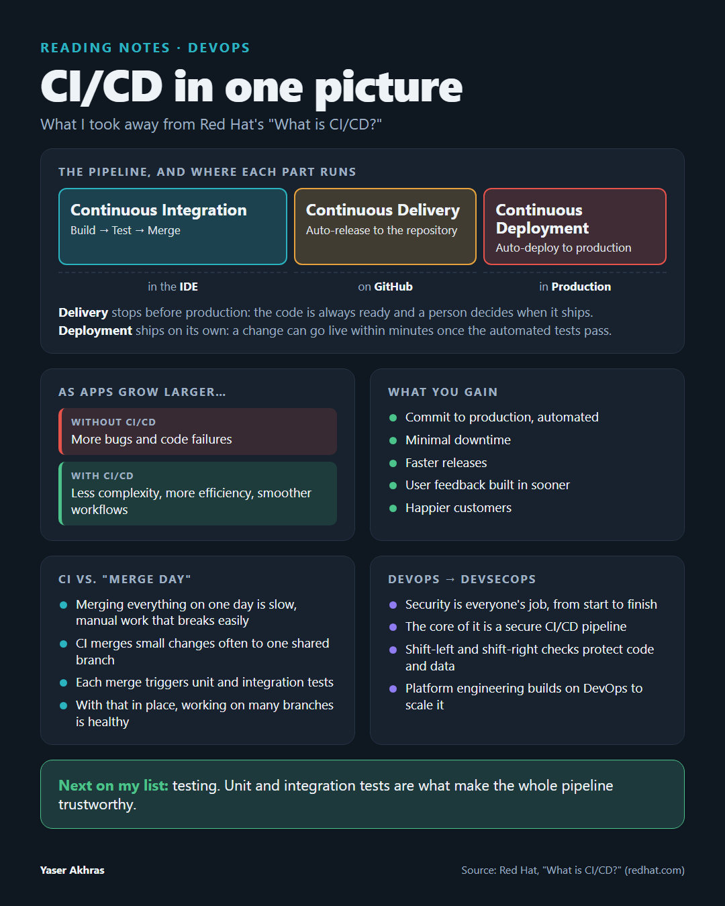


I read Red Hat's article [What is CI/CD?](https://www.redhat.com/en/topics/devops/what-is-ci-cd) with a highlighter in hand. These are the ideas I kept, in my own words.
<!--ar-->
قرأتُ مقال Red Hat ‏[ما هو CI/CD؟](https://www.redhat.com/en/topics/devops/what-is-ci-cd) وقلم التظليل في يدي. هذه هي الأفكار التي احتفظتُ بها، بكلماتي الخاصة.



## The pipeline: three stages, three places

The way I picture it, each stage runs somewhere different:

| Stage | What happens | Where |
|---|---|---|
| **Continuous Integration** | Build → Test → Merge | in the IDE |
| **Continuous Delivery** | Validated code is released to the repository automatically | on GitHub |
| **Continuous Deployment** | Released code goes to production automatically | in Production |

Red Hat calls these connected practices the **CI/CD pipeline**.
<!--ar-->
## المسار: ثلاث مراحل في ثلاثة أماكن

كما أتصوّره، تعمل كل مرحلة في مكان مختلف:

| المرحلة | ما يحدث | أين |
|---|---|---|
| **التكامل المستمر** | بناء ← اختبار ← دمج | في بيئة التطوير (IDE) |
| **التسليم المستمر** | تُصدَر الشيفرة التي تم التحقق منها إلى المستودع تلقائيًا | على GitHub |
| **النشر المستمر** | تنتقل الشيفرة المُصدَرة إلى بيئة الإنتاج تلقائيًا | في بيئة الإنتاج |

تُسمّي Red Hat هذه الممارسات المترابطة **مسار CI/CD** ‏(CI/CD pipeline).



## Why it matters

As apps grow larger, working without CI/CD means more bugs and code failures. CI/CD helps to "decrease complexity, increase efficiency, and streamline workflows". In practice that means:

- code goes from commit to production automatically,
- downtime is kept to a minimum,
- releases happen faster,
- user feedback gets built in sooner and more often,
- and in the end, customers are happier.
<!--ar-->
## لماذا يهمّ ذلك

مع تزايد حجم التطبيقات، يعني العمل دون CI/CD مزيدًا من الأخطاء وأعطال الشيفرة. يساعد CI/CD على «تقليل التعقيد، وزيادة الكفاءة، وتبسيط سير العمل». وعمليًا يعني ذلك أن:

- الشيفرة تنتقل من الإيداع (commit) إلى الإنتاج تلقائيًا،
- وقت التوقف يبقى في حدّه الأدنى،
- الإصدارات تصدر بشكل أسرع،
- ملاحظات المستخدمين تُدمَج أبكر وبوتيرة أعلى،
- وفي النهاية، يصبح العملاء أكثر رضا.



## CI vs. "merge day"

Without CI, teams often merge every branch together on a single "merge day", which is slow, manual work that breaks easily. CI replaces that with frequent merges to one shared branch. Every merge triggers automated tests, usually **unit and integration tests**, to make sure nothing broke.

My takeaway: **with CI in place, working on many branches is healthy**, not a risk.
<!--ar-->
## CI مقابل «يوم الدمج»

بدون CI، كثيرًا ما تدمج الفرق كل الفروع معًا في «يوم دمج» واحد، وهو عمل يدوي بطيء وسهل التعطّل. يستبدل CI ذلك بعمليات دمج متكررة في فرع مشترك واحد. وكل عملية دمج تُطلق اختبارات آلية، عادةً **اختبارات الوحدات واختبارات التكامل**، للتأكد من أن شيئًا لم يتعطّل.

ما خرجتُ به: **مع وجود CI، يصبح العمل على فروع كثيرة أمرًا صحيًا** لا مخاطرة.



## The two CDs: delivery vs. deployment

- **Continuous delivery** keeps the codebase *always ready* to deploy. A person still decides when it goes to production.
- **Continuous deployment** removes that manual gate. A change "could go live within minutes of writing it (assuming it passes automated testing)."

So deployment is only as safe as your test automation.
<!--ar-->
## الـ CD مرتين: التسليم مقابل النشر

- **التسليم المستمر** يُبقي الشيفرة *جاهزة دائمًا* للنشر، لكن شخصًا ما يظل هو من يقرر متى تنتقل إلى الإنتاج.
- **النشر المستمر** يزيل هذه البوابة اليدوية، فيمكن للتغيير «أن يصبح متاحًا خلال دقائق من كتابته (بشرط اجتيازه الاختبارات الآلية)».

أي أن النشر لا يكون آمنًا إلا بقدر جودة اختباراتك الآلية.



## From DevOps to DevSecOps

DevOps and CI/CD share one goal: getting an idea from development into production faster. DevSecOps adds that security is a shared responsibility from start to finish, and its core is a **secure CI/CD pipeline**. Shift-left and shift-right security checks help protect code, prevent data leaks and keep you compliant. Platform engineering builds on DevOps to scale all of this across teams.
<!--ar-->
## من DevOps إلى DevSecOps

يشترك DevOps وCI/CD في هدف واحد: نقل الفكرة من التطوير إلى الإنتاج بشكل أسرع. ويضيف DevSecOps أن الأمان مسؤولية مشتركة من البداية إلى النهاية، وجوهره **مسار CI/CD آمن**. تساعد فحوصات الأمان المبكرة (shift-left) والمتأخرة (shift-right) على حماية الشيفرة، ومنع تسرّب البيانات، والالتزام بالمعايير. وتبني هندسة المنصات (Platform engineering) على DevOps لتوسيع كل ذلك عبر الفرق.



## What's next for me

Every stage above depends on good tests. My note in the margin says it plainly: *"We need to learn more about Test."* Unit and integration testing is my next topic.
<!--ar-->
## ما التالي بالنسبة لي

كل مرحلة مما سبق تعتمد على اختبارات جيدة. ملاحظتي في الهامش تقولها بوضوح: *«نحتاج أن نتعلّم المزيد عن الاختبار.»* اختبارات الوحدات والتكامل هي موضوعي التالي.


---


*Source: Red Hat, ["What is CI/CD?"](https://www.redhat.com/en/topics/devops/what-is-ci-cd), updated June 10, 2025. Quotes are short excerpts; the rest is my summary.*
<!--ar-->
*المصدر: Red Hat، ‏[«ما هو CI/CD؟»](https://www.redhat.com/en/topics/devops/what-is-ci-cd)، تاريخ التحديث 10 يونيو 2025. الاقتباسات مقتطفات قصيرة مترجمة، والباقي تلخيصي.*

