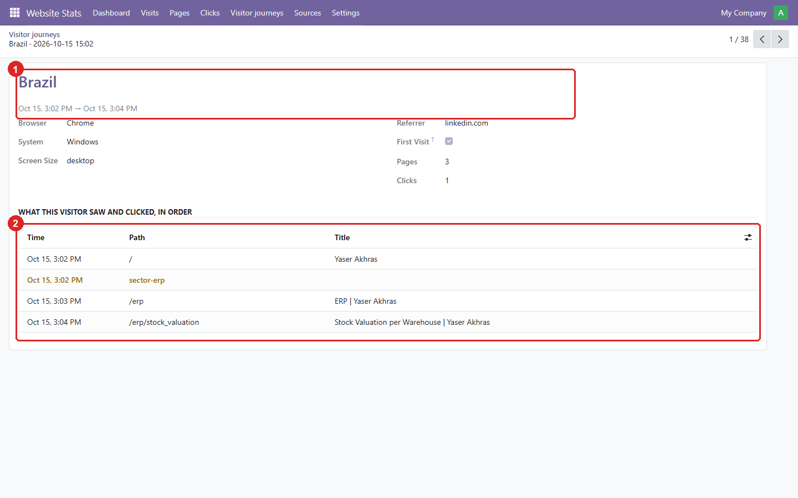
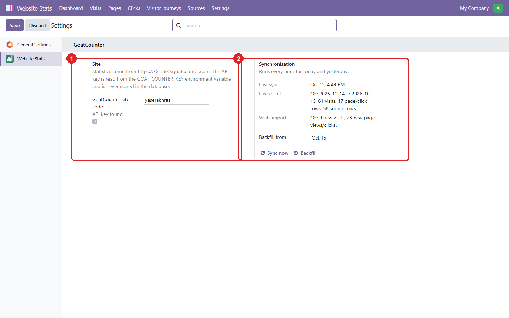

An Odoo module that pulls a website's [GoatCounter](https://www.goatcounter.com) statistics into
Odoo through the GoatCounter API. Visits, pages, clicks, traffic sources and each visitor's path
through the site appear next to the rest of your work, so you don't have to open goatcounter.com.
This site's own statistics are read this way.

**Source:** [github.com/yakhras/Odoo-GoatCounter-Stats](https://github.com/yakhras/Odoo-GoatCounter-Stats) · **License:** AGPL-3 · **Odoo:** 19.0

## Features

- A dashboard for 7, 30 or 90 days or all time: page views and clicks compared with the previous
  period, a daily chart, top pages, click events, countries, referrers, browsers, systems and
  screen sizes
- Visitor journeys: what each visit saw and clicked, in order, grouped by GoatCounter's session
- Click events for every link tagged with `data-goatcounter-click`
- An hourly sync, plus *Sync now* and a backfill from any date
- The API key is read from an environment variable and never stored in the database
- Only administrators see the data
- Covered by 18 automated tests, run by GitHub Actions on every push

It doesn't show names, emails or IP addresses, because GoatCounter doesn't collect them. A visit
is one browser session, not a person.

## Screenshots

These use generated demo data. The dashboard, with every metric on one page:


One row per visit, with the pages and clicks (★) it went through:


A visitor from Brazil: what they saw and clicked, in order:



Settings: the site code, whether the API key was found, and the sync results:



## Installation

```bash
git clone -b 19.0 https://github.com/yakhras/Odoo-GoatCounter-Stats.git
```

Add the cloned folder to `addons_path` and give Odoo the API key as the `GOAT_COUNTER_KEY`
environment variable. The key needs the *Read statistics* and *Export* permissions. Then restart
Odoo and install **GoatCounter Website Stats**. Full setup steps are in the
[repository README](https://github.com/yakhras/Odoo-GoatCounter-Stats#readme).
