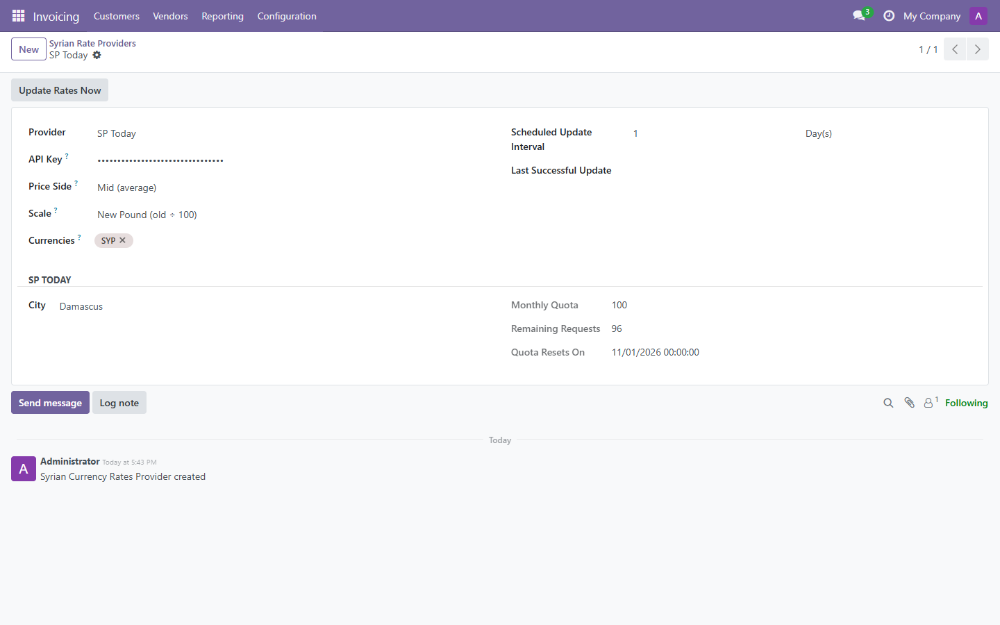
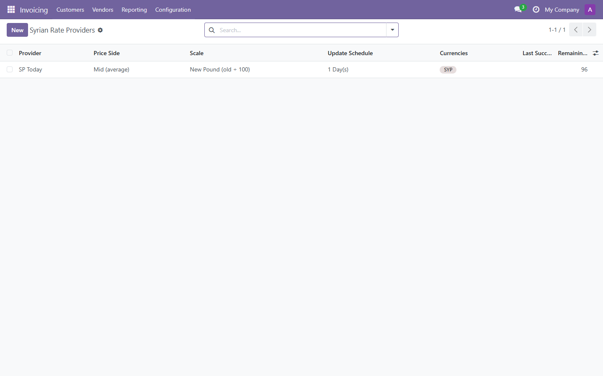
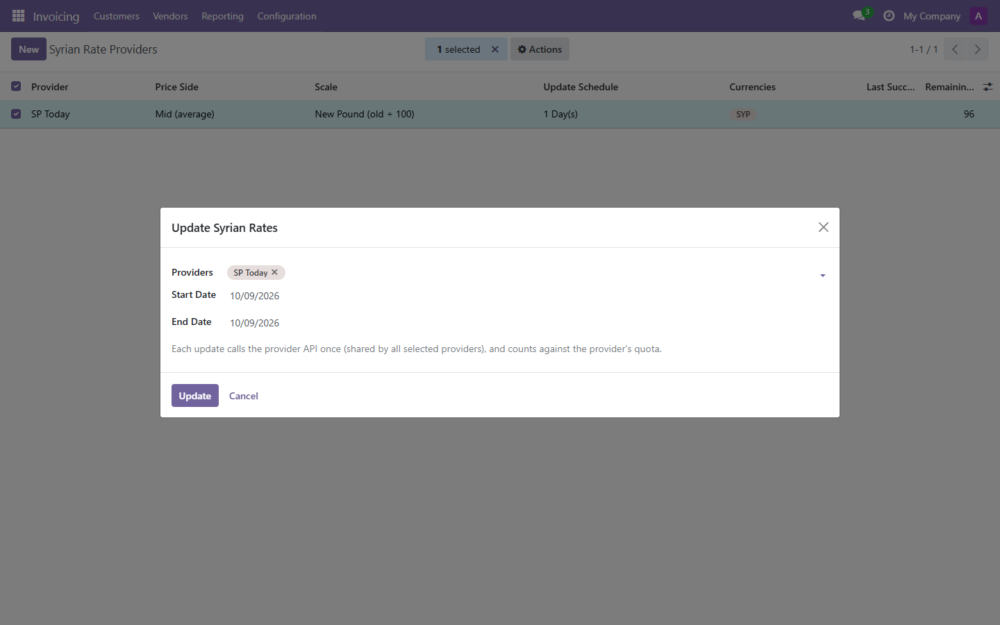
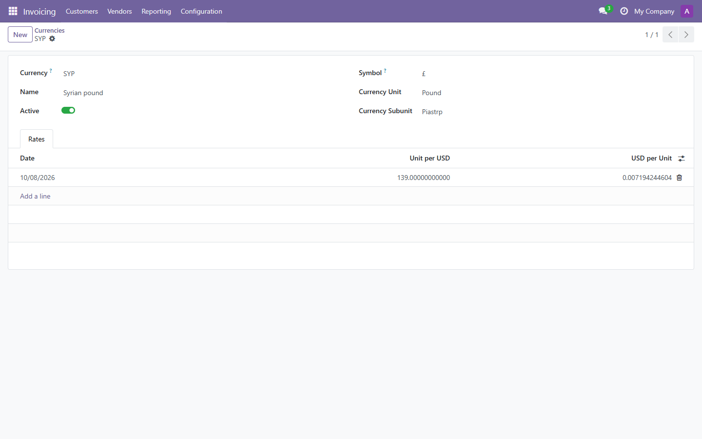

Odoo API integration that keeps **Syrian Pound (SYP)** exchange rates up to date from Syrian
market rate providers. The supported provider is **[SP Today](https://sp-today.com)**, and the
design is extensible to other sources.

**Source:** [github.com/yakhras/Odoo-SPT](https://github.com/yakhras/Odoo-SPT) · **License:** LGPL-3 · **Odoo:** 18.0

## Features

- Fetches SYP market rates from the SP Today API (Damascus, Aleppo or Homs)
- One rate provider per company (multi-company safe)
- Choice of price side: **Buy**, **Sell** or **Mid (average)**. Buy and sell are stored on the rate as well.
- Old / new Syrian pound scale (new = old ÷ 100), converted automatically
- Scheduled updates at a configurable interval (days / weeks / months)
- Manual update: an **Update Rates Now** button, plus a wizard for a date range
- Shows the remaining API quota (monthly limit, remaining requests, reset date)
- Coexists with other currency rate providers without conflicts

## Screenshots

Provider configuration:



All providers with price side, scale, schedule and remaining API quota:



Update several providers at once:



Resulting SYP rates:



## Installation

```bash
git clone -b 18.0 https://github.com/yakhras/Odoo-SPT.git
```

Restart Odoo, update the apps list, and install **SPT**. Full documentation is in the
[repository README](https://github.com/yakhras/Odoo-SPT#readme).
