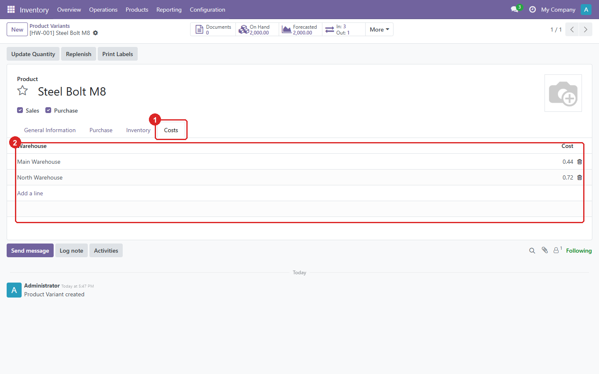
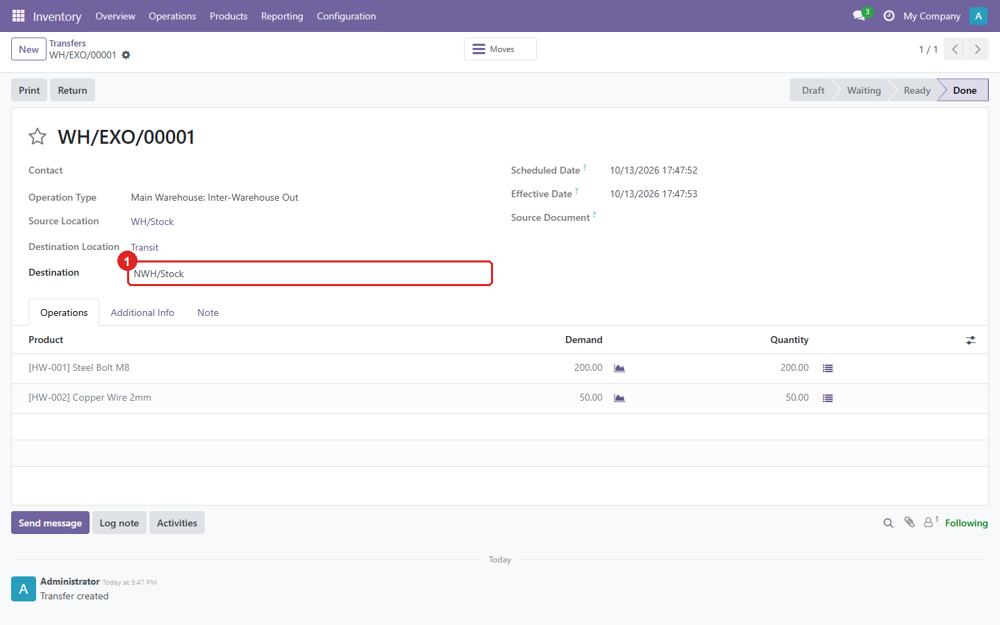

An Odoo module that values stock **per warehouse** instead of once per company. Standard Odoo
keeps one average cost per product, so goods bought at different prices in different warehouses
all end up at the same blended cost. With this module, each warehouse keeps its own cost.

**Source:** [github.com/yakhras/Odoo-Stock-Valuation](https://github.com/yakhras/Odoo-Stock-Valuation) · **License:** AGPL-3 · **Odoo:** 18.0

## Features

- A separate cost for each product and warehouse, updated with AVCO on every receipt
- A history of every cost change: old and new cost, difference, user and date
- Valuation layers carry their warehouse, so deliveries are valued at their own warehouse's cost
- Stock lists show *Unit Value* and *Value* per warehouse
- Landed costs raise only the receiving warehouse's cost, prorated to the stock that remains
- The revaluation wizard works on one warehouse at a time
- Transfers between warehouses (EXO → EXI) move the value along with the goods
- Covered by 16 automated tests

## Screenshots

Every product and warehouse cost in one list:


The same product is worth 0.44 in one warehouse and 0.72 in the other:


Each product's costs, on its own tab in the product form:



Revaluation of one warehouse:


A transfer between warehouses: validating the EXO creates the EXI for the destination warehouse:



## Installation

```bash
git clone -b 18.0 https://github.com/yakhras/Odoo-Stock-Valuation.git
```

Add the cloned folder to `addons_path`, restart Odoo, update the apps list and install
**Stock Valuation per Warehouse**. Products need an AVCO costing method; FIFO isn't supported
yet. Full documentation and known limitations are in the
[repository README](https://github.com/yakhras/Odoo-Stock-Valuation#readme).
