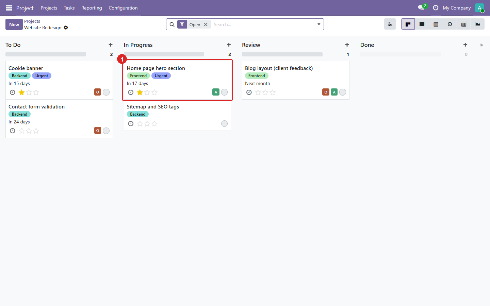

An Odoo module that imports [Trello](https://trello.com) boards into Odoo Projects through the
Trello REST API. Lists become stages, cards become tasks, and comments, checklists and
attachments come along. You decide, board by board and list by list, where everything lands, so
nothing is duplicated.

**Source:** [github.com/yakhras/Odoo-Trello](https://github.com/yakhras/Odoo-Trello) · **License:** AGPL-3 · **Odoo:** 

## Features

- Each board is either linked to an existing project or creates a new one, and nothing syncs
  until you confirm. A project can't be linked to two boards, and no second project is created
  with the same name
- Each list is merged into an existing stage or creates a new one. A list added in Trello later
  waits as *Unmapped*, and its cards are skipped until you map it
- Cards become tasks: description, checklists, deadline, labels as tags, and members as
  assignees
- A label such as *Urgent* stars the task. A card whose due date is marked complete, or that
  sits in a *Done* list, becomes a Done task. An archived card archives its task
- Comments become notes in the task's chatter. Uploaded images, audio and documents are copied
  into Odoo; link attachments and very large files stay as links
- Your Odoo edits are kept: rename a task or move it to another project, and it stays linked
  to its card. A sync only overwrites what changed in Trello since the last sync
- Nothing is ever deleted, and the sync polls Trello every 15 minutes, so it also works on an
  Odoo server the internet can't reach
- Covered by 34 automated tests, run by GitHub Actions on every push

The sync runs one way, from Trello to Odoo.

## Screenshots

These use generated demo data. Mapping a board: link it to a project, then map each list to a
stage:


An active board, with a list added in Trello later that waits to be mapped:


The imported tasks: lists became stages, labels became tags, and *Urgent* gives the star:



One task, with the card's checklist, its attachments and the Trello comments:


A task renamed in Odoo still knows its card's name, and stays linked to it:


## Installation

```bash
git clone -b 19.0 https://github.com/yakhras/Odoo-Trello.git
```

Add the cloned folder to `addons_path`, restart Odoo and install **Trello**. Then create an API
key and a read-only token in Trello and enter them under *Project → Configuration → Settings*.
Full setup steps are in the [repository README](https://github.com/yakhras/Odoo-Trello#readme).
